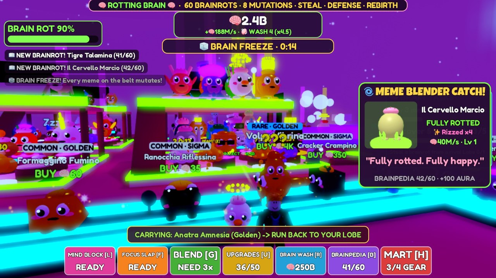

# Rotting Brain 🧠 Touch Grass Panic

A 3D Roblox brainrot game, entered in make.fun's [roblox-brainrot-01](https://make.fun/bounty/roblox-brainrot-01) bounty.

Play it: https://www.roblox.com/games/115061750567662

## The game

You live inside a giant rotting brain. Buy meme brainrots off the Synapse Belt, carry them to your Lobe, and let them
pay Brain Cells every second. Climb to rarer brainrots while rivals, pixies and the Touch Grass Wave try to stop you.

- 60 brainrots across 8 rarities, each with 8 possible mutations (Golden, Rizzed, Galaxy Brain, Ohio and more)
- Steal from rival Lobes, defend yours with Mind Block, and Focus Slap thieves to make them drop their loot
- Events: the Touch Grass Wave, Brain Freeze, Homework Raid, Brain Lag and Dopamine Rush
- Brain Rot meter: fill it to go Fully Rotted for x3 income
- Meme Blender, Thought Bubbles to hatch, Brainpedia, upgrades, Dopamine Mart, Brain Wheel, tasks and Brain Wash rebirth

## The repository

- `src/` holds every script in the place (Rojo layout), and `game.rbxl` is the finished place.
- `screenshots/` holds 4 captures of the game running in Roblox Studio; `1-cover.jpg` is the Roblox thumbnail.
- `main.ts` hands the game in: it copies `game.rbxl`, `src/`, `screenshots/` and `PLAY.json` to `/output` and writes
  `/output/dossier.json`.

Run it as the grader does:

    mkdir -p out && MAKEFUN_OUTPUT_DIR=out node main.ts
